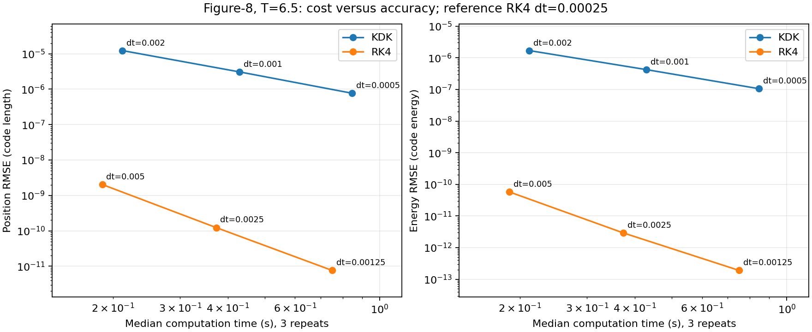
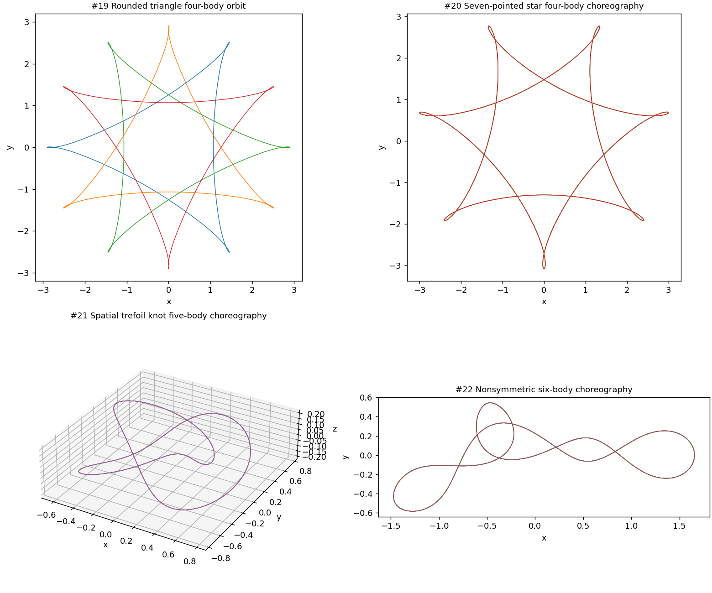
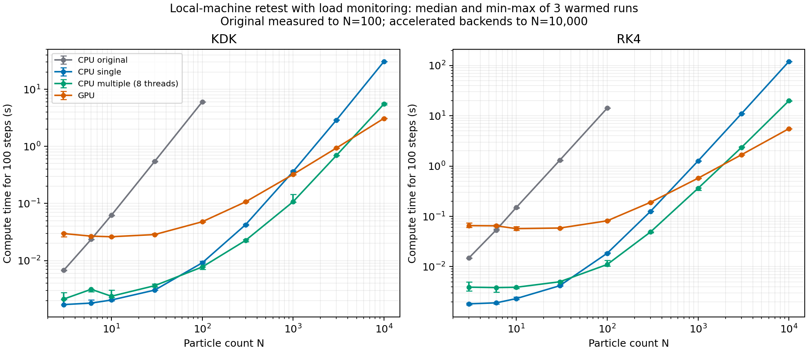
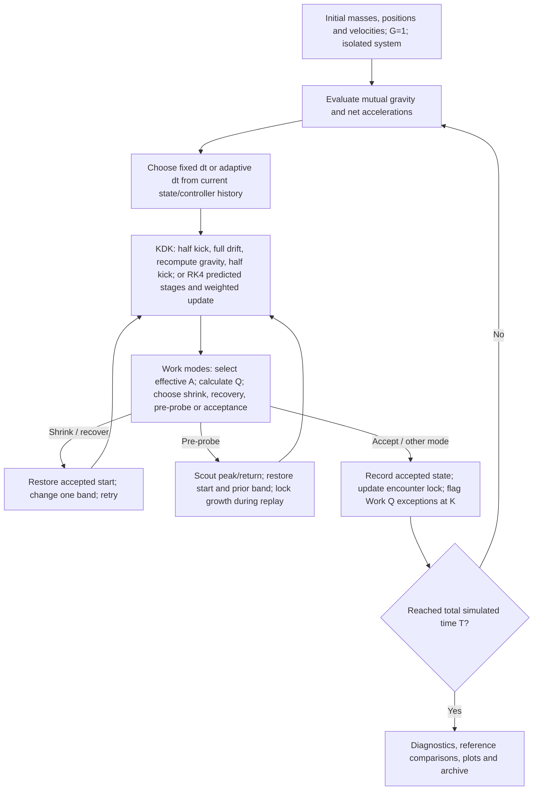

<p align="center">
  <a href="https://nbody-lab-charlie.zsh13718187275.chatgpt.site">
    
  </a>
</p>

<h1 align="center"><a href="https://nbody-lab-charlie.zsh13718187275.chatgpt.site">🚀 CLICK TO LAUNCH N-BODY LAB 🚀</a></h1>

<p align="center"><strong>Run the simulation in your browser · No installation required</strong><br>The required runtime loads automatically on first use. Please allow initialization to finish.</p>

---

# Interactive N-Body Lab

**A Python laboratory for Newtonian N-body dynamics, numerical-error analysis, adaptive time stepping, and CPU/CUDA comparisons.**

## Try the web version

**[Open N-body Lab in your browser](https://nbody-lab-charlie.zsh13718187275.chatgpt.site)** — explore the simulation online without installing Python, setting up an environment, or installing libraries. The required Python runtime and libraries load automatically in your browser on first use, so the initial launch may take some time. Computation runs locally in your browser.

## Download and run the Lab

**[Download the N-body Lab source ZIP](https://github.com/Charlie-Zhao-666/N-Body-Simulation/raw/refs/heads/main/downloads/NBody-Lab-source.zip)** (2026-11-13). The ZIP includes the desktop application, built-in orbits, helper modules, dependency lists, and a [Chinese setup and file guide](downloads/RUN_LAB.md). Extract the entire ZIP into a writable folder. You can start a new simulation without downloading historical plots or trajectories.

For a first run on Windows, install desktop Python with Tk support, open PowerShell in the extracted folder, and run:

```powershell
python -m venv .venv
.\.venv\Scripts\python.exe -m pip install -r requirements-base.txt
.\.venv\Scripts\python.exe "N body simulation Lab.py"
```

Select **CPU (dictionary / original)** and a preset orbit, then run Leapfrog or RK4. To use the default multi-threaded CPU backend, install `requirements-array-cpu.txt` in the same environment. The guide lists the additional requirements for DOP853, Taylor and GPU modes.

## Repository source

The repository-root application and downloadable ZIP were synchronized with the local energy-band version on 2026-11-13 (main application last modified 2026-11-11). The main application is [`interactive_nbody_lab.py`](interactive_nbody_lab.py). Its manual image-export default uses the portable local output folder. The packaged application has the same source under the filename `N body simulation Lab.py`. It brings the original model, conservation diagnostics, acceleration tracking, adaptive steps, optional GPU computation, and repeatable batch experiments into one desktop interface.

I started this personal project because I find N-body dynamics fascinating and enjoy building simulations to explore how these systems behave. It is still under active development. Implemented features and tested cases are listed separately from future work; a numerically computed reference trajectory is not an exact analytic answer.

Sister project: [Neutron-Star-Modeling](https://github.com/Charlie-Zhao-666/Neutron-Star-Modeling).

## Completed features

Listed by development stage, starting with the original model and continuing through the later interactive features. KDK was used in the original model; RK4 was added later as a selectable alternative. Later refinements within a stage are described together.

1. **Build the physical model:** Direct pairwise Newtonian gravity in 3D, with particle masses, positions and velocities, using computational units with G=1 and the original leapfrog update. Finite-precision point masses; no softening, collisions or merger prescription.
2. **Add energy and conservation-error analysis:** Track energy, momentum, angular momentum and center-of-mass velocity; calculate RMSE and normalized energy RMSE. Conservation error alone does not certify trajectory accuracy.
3. **Add seed control and known periodic initial conditions:** Random and specified seeds, followed by a catalog of known orbit initial conditions, now containing 23 options in the interactive application. Published numerical initial conditions have finite precision; the catalog is not a set of analytic position functions.
4. **Add the KDK / RK4 method choice:** Extend the existing leapfrog kick-drift-kick (KDK) program with classical fourth-order Runge-Kutta (RK4), sampling-rate options and end-of-run saving. Both methods were subsequently exercised in time-step and orbit comparisons.
5. **Build the interactive acceleration view:** Introduce the Tkinter/Matplotlib interface, per-star net-acceleration records and star selection alongside energy curves. Subsequent interface updates added velocity records, per-step travel distance, a draggable timeline/time cursor, hover readouts, fixed/follow/fit-all views and actual-dt overlays. Energy can be displayed as E or E-E(0).
6. **Add timescale-based adaptive stepping:** Choose the step from pairwise timescales with an adjustable safety factor eta. Adaptive stepping does not automatically retain the geometric properties of fixed-step leapfrog.
7. **Add GPU computation:** Introduce an optional CuPy RawKernel CUDA backend alongside the NumPy/Python CPU path, both using float64. Later validation includes the dictionary/GPU crossover study and a 240-run comparison with compiled single-/multi-thread CPU backends; see the measured results below. Desktop rendering remains CPU-based.
8. **Add acceleration-ratio adaptive stepping:** Extend the adaptive choices with per-star acceleration monitoring, adjustable trigger ratio N and exponent cap K. Both adaptive approaches were subsequently compared on Butterfly I.
9. **Expand run recording and export:** Add aligned DAT history, full-precision JSON summaries, linked PNG conservation plots and animation export. Local outputs use the script's graph and data directory; later batch runs also archive full NPZ arrays. Large raw arrays are excluded from Git.
10. **Add batch Test mode:** Editable test configurations and importable JSON plans, sequential execution and automatic saving. Later reference-ordering refinements make the smallest dt the default reference while honoring an explicitly selected reference, which always runs first.
11. **Add trajectory-error comparisons:** Reference-based position RMSE/NRMSE and optional comparison with the previous executed test. Comparisons require identical initial masses, positions, velocities and particle order, and use a common physical-time grid with cubic Hermite interpolation.

12. **Add energy-drift fitting:** Fit energy deviation against physical time and record signed/normalized slopes. This began with sampled fits; current default statistics use the full accepted record with physical-time weighting. A near-zero slope does not by itself prove small excursions or return to the original energy.
13. **Optimize CPU computation:** Preserve the dictionary CPU baseline and add float64 NumPy-array state with Numba-compiled single-thread and multi-thread loops. Choose the backend and worker count in the interface. The direct-gravity calculation remains O(N^2); these modes reduce interpreter overhead and distribute target-particle work.
14. **Expand the orbit catalog:** Add spatial and higher-body examples, most recently four-body rounded triangles and a seven-pointed star, a five-body spatial trefoil, and a six-body nonsymmetric choreography. Sources, finite-precision limitations and stability distinctions are documented; not all periodic orbits are stable.

The early milestones are recorded in commits [4893a91](https://github.com/Charlie-Zhao-666/N-Body-Simulation/commit/4893a91) (original model and conservation analysis), [c9f606c](https://github.com/Charlie-Zhao-666/N-Body-Simulation/commit/c9f606c) (seed control), [5daddb6](https://github.com/Charlie-Zhao-666/N-Body-Simulation/commit/5daddb6) (known orbits) and [ee2b2e4](https://github.com/Charlie-Zhao-666/N-Body-Simulation/commit/ee2b2e4) (RK4 selection). Later interactive development was published together in [18a13f5](https://github.com/Charlie-Zhao-666/N-Body-Simulation/commit/18a13f5); its stages above follow the development record, not separate per-feature Git timestamps.

## Step energy error band update (2026-11-13)

The current application includes **Step energy error band**, DOP853, Taylor45/100/150/200, and optional MPFR precision backends. The ZIP and repository-root source include the companion modules required by these features. See the [updated setup and file guide](downloads/RUN_LAB.md) and [Taylor backend guide](TAYLOR_README.md).

To try the energy-band controller, enable adaptive time stepping and select **Step energy error band**. Set the lower and upper limits on the measured absolute single-step total-energy change. **Node drift limit** additionally limits the offset from the initial energy at accepted nodes; zero disables this guard. With a positive limit, the energy plot shows red dashed drift bounds. Rejected trials restart from the same accepted state. The final clipped step and the cumulative-priority rule can waive the lower bound. These checks use float64 energy snapshots and do not provide a bound on trajectory position error.

This publication synchronizes the existing implementation. The earlier experiment reports below retain their original versions and scopes.

## Work scale research update (2026-11-02)

I am currently testing four variants of my experimental **Work scale** adaptive controller: **Original, Align, Average and Predicted**. The question is which choice best resolves close encounters when energy error, fitted drift and actual computation cost are considered together. There is no overall winner yet. The older conversational name was Work skill; the application uses Work scale.

All four use starting velocity and the same mass-weighted, normalized two-term indicator:

$$Q=\max_i\frac{m_i}{S_E}\left(|\mathbf A_i\cdot\mathbf v_{i,\mathrm{start}}|h+\frac12|\mathbf A_i|^2h^2\right),\qquad S_E=E_{\mathrm{kin}}(0)+|E_{\mathrm{pot}}(0)|.$$

Here h is the attempted step, m_i the particle mass, v_start the starting velocity, and A the selected effective acceleration. Both terms multiplied by mass have energy units; division by the fixed positive initial scale S_E makes Q dimensionless. The difference between variants is **which acceleration vector enters both terms**:

| Variant | Effective acceleration A |
|---|---|
| Original | Trial-end acceleration |
| Align | Starting acceleration, aligned in time with starting velocity |
| Average | Arithmetic mean of starting and trial-end acceleration vectors |
| Predicted | Current accepted acceleration + half its difference from the preceding accepted acceleration |

For Predicted, previous=1 and current=2 gives **2.5**, not 2.25; the first step uses current acceleration. Average can have vector cancellation; Predicted does not correct for unequal old/new time intervals. Neither construction guarantees a more accurate error estimate.

If Q is too large, the controller restores the accepted start and retries at a smaller h0/N^k band. If Q is sufficiently small, it can retry a larger band. **At the K cap, over-threshold trials are accepted and flagged.** Q is a work scale, not measured total-energy error or a percentage-error tolerance.

**Encounter Pre-probe** addresses premature recovery during a rising-acceleration encounter: scout ahead temporarily, restore the starting checkpoint, and replay with growth blocked through the encounter window. Further shrinking remains possible. Temporary scout states/history never enter the formal trajectory, and scouting counts toward cost. It does not restore a proven time-symmetric adaptive KDK or directly correct energy.

Current evidence, with pre-probe enabled:

- In eight deterministic cases that activated adaptation, **all four variants lowered energy RMS** relative to fixed stepping at the same initial dt. For **RK4**, all four also lowered the magnitude of the fitted finite-time energy slope in all eight cases.
- **KDK:** smaller energy excursions can accompany worse fitted drift. State-dependent acceptance/recovery does not automatically retain fixed-step KDK's time symmetry.
- **RK4:** the large energy-error and drift reductions are a promising result for the tested cases, not proof that long-time drift is eliminated in general.
- **Cost:** concentrating small steps near encounters is potentially efficient compared with using a very small fixed step everywhere. The current same-initial-dt tests are usually slower than the coarse fixed baseline and do not establish a general equal-accuracy speedup.
- **Variant ranking:** Predicted improves some RK4 cases but worsens others; Average and Align also have counterexamples. The Goggles ten-period test shows that improved energy conservation need not recover the original periodic shape.

Read the [algorithm, exact rejection/recovery and pre-probe flow](docs/adaptive-stepping.md), [research notes (Chinese)](docs/work-scale-zh.md), and [settings, results, caveats and source snapshots](docs/reports/2026-11-02-work-scale/README.md). Load the [eight-run KDK/RK4 four-variant plan](plans/work-scale-four-methods.json) for a short demonstration; it is not the full comparison suite. [Publication checks](docs/reports/2026-11-02-work-scale/publication-checks.json).

The current code also includes the configurable eccentric Kepler binary with an analytic position reference, encounter/indicator diagnostics and portable exports. Retired Work scale Test/Align/Wide variants and total-energy-ratio stepping cannot start new runs; old records remain readable. The October 20 dimensional indicator is historical and differs from today's normalized formula.

## Quick start

Install Python with Tk support, then install the CPU requirements and launch the interface:

```sh
python -m pip install -r requirements.txt -r requirements-array-cpu.txt
python interactive_nbody_lab.py
```

`stable_orbits.py`, `nbody_array_cpu.py`, `nbody_cpu_startup.py` and `nbody_kepler.py` must remain beside the application. The default multi-thread CPU backend requires Numba; select dictionary CPU if you install only `requirements.txt`. For either array CPU mode, also run `python -m pip install -r requirements-array-cpu.txt`; dictionary CPU does not require Numba. The optional dependency was previously tested with Numba 0.68.0. See [CPU mode details](ARRAY_CPU_README.txt). Tkinter ships with the standard Windows Python installer; other operating systems may require their distribution's Tk package. November 2 publication checks used Python 3.12.14 and NumPy 2.5.4; the earlier desktop setup used Python 3.14, NumPy 2.4.3, Matplotlib 3.10.8, Pillow 12.1.1 and python-dateutil 2.9.0.post0. Check records identify the tested environment rather than prescribing identical package versions on every host.

In the main window, choose initial conditions, integrator, **dt**, **total simulated time T**, diagnostics sampling and CPU/GPU. Start the run to compute the trajectory and inspect the resulting tabs. Here **T is physical simulation time in code units**, not a step count. `Steps_set=ceil(T/dt)`; adaptive runs can execute more steps.

For GPU mode, install a CuPy package compatible with your NVIDIA driver/CUDA environment using the [official CuPy installation guide](https://docs.cupy.dev/en/stable/install.html). The author's environment has `cupy-cuda13x 14.2.0`; that is not a requirement for every machine. CPU mode does not require CuPy.

### Repeatable batch experiments

The [original four experiments and two supplementary trials](plans/historical/README.md) now have loadable plans mapped to their historical data rows.

Open **Test mode**, use **Load plan**, and select a JSON file from [`plans/`](plans/). Each plan contains initial conditions, dt, integrator, total duration, diagnostics settings and position-comparison settings. Start the batch to run the cases sequentially.

- The reference runs first, even if a different case has a shorter dt.
- Other cases run in ascending configured dt order.
- Each completed test saves its parameters, diagnostics, conservation figure and full per-step arrays.
- Position errors are evaluated at shared physical times; comparing equal array indices would be incorrect when time steps differ.
- `reference_N` in the history denotes a reference shared by N completed comparisons. Unrequested/unavailable metrics are `NA`.
- Large plans can use substantial time and RAM because the current application retains every step. The long-time and Butterfly plans should be run deliberately.

## Published experiments and results

Browse the [run history and clickable images](data/run-history/README.md), the [full clickable table](data/run-history/runs.md), the [aligned runs.dat](data/run-history/runs.dat), and the [test log](docs/test_report.txt).

The original experiments are also available as [importable historical plans](plans/historical/README.md):

- **Lines 36-44:** Butterfly I KDK time-step scan — 9 runs.
- **Lines 49-50:** Butterfly I KDK/RK4 comparison at the same dt — 2 runs.
- **Lines 53-60:** Butterfly I fixed-step reference and adaptive-method comparison — 8 runs.
- **Lines 67-69:** Butterfly I proposed cost-matched KDK/RK4 comparison — 3 runs; the dt factor does not guarantee equal measured cost.
- **Lines 61-63 and 64-66:** Two supplementary method/time-step trials — 3 runs each.

The 2026-10-07 suite completed **45 runs on an Intel Core i9-13900K CPU**, with full local trajectory archives. These are **CPU results**, not evidence of GPU speedup.

- **Lines 77-81:** Figure-8 numerical-reference validation, T=6.5 — 5 runs.
- **Lines 82-100:** Figure-8 cost/accuracy scans, three repeats per tested method/dt — 19 runs.
- **Lines 101-104:** Figure-8 long-time comparison, T=65 — 4 runs.
- **Lines 105-108:** Figure-8 long-time comparison, T=650 — 4 runs.
- **Lines 109-121:** Butterfly I fixed steps, timescale adaptation and acceleration-ratio adaptation — 13 runs.

[Full results, settings, limitations and six comparison plots](docs/reports/2026-10-07/results.md).



Within these Figure-8 tests, RK4 produces smaller position differences at similar or slightly lower measured CPU cost than the paired KDK cases, including at T=650. On Butterfly I, the tested fixed RK4 h/4 case is both faster and more accurate in position than the three tested acceleration-ratio settings. These are findings for the tested initial conditions, durations, implementations and references, not a universal ranking of integrators.

Energy figures distinguish bounded oscillations from drift. KDK can preserve angular momentum more accurately while having a larger position error. The detailed comparison additionally resamples recorded energy onto common physical times, because native diagnostic sampling differs between adaptive modes.

## Repository layout and version strategy

| Path | Purpose |
|---|---|
| `interactive_nbody_lab.py` | Current interactive application; published under an English filename |
| `stable_orbits.py` | Shared initial-condition catalog; 23 interactive choices including free-fall and configurable Kepler-binary entries |
| `nbody_array_cpu.py` | Optional Numba single-/multi-thread CPU implementation |
| `nbody_cpu_startup.py` | Background startup preparation for both CPU backends |
| `nbody_kepler.py` | Configurable eccentric binary and analytic position reference |
| `docs/adaptive-stepping.md` | Four Work scale variants, recovery, pre-probe, limits and interpretation |
| `docs/work-scale-zh.md` | Chinese explanation of the current research and debugging process |
| `docs/reports/2026-11-02-work-scale/` | Four-variant energy/drift/cost evidence and exact numerical source snapshots |
| `requirements-array-cpu.txt` | Optional dependency for array CPU modes |
| `N body simulation.py` | Original console-driven program, retained for continuity |
| `Galaxies collision simulation.py` | Earlier separate galaxy-collision visualization demo |
| `requirements.txt` | CPU application dependencies |
| `plans/` | Loadable historical experiments and the latest four-backend workload |
| `data/run-history/` | Published snapshot: 388 records, 386 linked lossless WebP plots, full-precision summaries and comparisons |
| `docs/test_report.txt` | Test descriptions and runs.dat line ranges |
| `docs/reports/2026-10-07/` | Detailed analysis, machine-readable metrics and summary figures |
| `docs/reports/2026-10-20-backends/` | Latest local CPU/GPU comparison: timings, crossover brackets, figures and source snapshot |
| `docs/orbits/2026-10-20/` | New orbit previews, provenance and checks |
| `docs/cpu_gpu_benchmark_plan.md` | Original benchmark protocol and links to completed studies |
| `docs/ROADMAP.md` | Completed, unfinished and proposed work |

The interactive application belongs to the existing **main development line**, rather than a separate repository. Earlier versions remain available in Git history. The existing `time-step-tester`, `method-tester`, `no-z-component-test`, and `images` branches remain as historical/specialized work; their READMEs describe those versions, not the current interface. Future unvalidated changes can use short-lived feature branches before joining main.

For the original console program, `mplcursors` may also be needed; install it separately if you run that legacy entry point.

### Published data versus local outputs

The current published snapshot contains **388 run records and 386 conservation plots**, plus 4 supplementary plots, exported on 2026-10-19. Two legacy records lack images. All run-history plots use lossless WebP. The [complete table](data/run-history/runs.md) and [compact table](data/run-history/README.md) provide clickable relative Plot links; `runs.dat` retains the aligned plain-text data. That snapshot is dated 2026-10-19. Subsequent updates add application code and separate benchmark evidence without rewriting the historical snapshot. Exact benchmark source is preserved with the new report.

**Full local NPZ trajectories are not uploaded.** Historical batch JSON files retain their NPZ output names as provenance, but the raw arrays are not included. New local runs create a separate `graph and data/` folder beside the program, ignored by Git. `data/run-history/` is a published snapshot and is not overwritten by running the application. Keep full arrays locally or use a dedicated data archive for future releases. GitHub recommends keeping repositories small and blocks ordinary Git files above 100 MiB; see [GitHub's large-file guidance](https://docs.github.com/en/repositories/working-with-files/managing-large-files/about-large-files-on-github).

A publication smoke check used the same five-body initial state and 10 fixed steps on the CPU and an NVIDIA GeForce RTX 5090 for both integrators; saved positions agreed at the tested precision. This only checks a short execution path, not general trajectory equivalence or performance. [Check record](docs/reports/publication_checks.json).

## New orbit examples

The catalog now includes **four-body rounded triangular loops and a seven-pointed star, a five-body 3D trefoil knot, and a six-body nonsymmetric periodic choreography**. In the interactive menu these are entries **19-22**. Earlier entries keep their indices. The trefoil is explicitly unstable; periodic existence must not be confused with perturbation stability. [Initial-condition provenance and local checks](docs/orbits/2026-10-20/README.md).



## Measured CPU/GPU performance and crossover

Tests ran on the author's **Intel Core i9-13900K and NVIDIA GeForce RTX 5090**, using float64. CPU optimization now offers the original dictionary implementation, a Numba array single-thread implementation, and a Numba array multi-thread implementation. Arrays avoid per-step dictionary conversion; compiled loops remove Python interpreter overhead. Multi-thread work is split by target particle with no shared output writes. No fast-math or gravitational softening is introduced.

The **2026-10-20 retest** contains 240 warmed measurements (80 configurations, three repeats). The particle sweep uses fixed dt=0.001, 100 steps, the same seed/initial arrays within each comparison, and **8 worker threads** for multi-thread CPU. Timings include integration, recording and diagnostics, excluding initialization/JIT, drawing and export.

| CPU baseline compared with GPU | KDK sampled crossover bracket | RK4 sampled crossover bracket |
|---|---:|---:|
| Original dictionary CPU | N=6 to 10 | N=6 to 10 |
| Array single-thread CPU | N=300 to 1000 | N=300 to 1000 |
| Array multi-thread CPU (8 workers) | N=3000 to 10000 | N=1000 to 3000 |

Each bracket lists a CPU-faster sampled point followed by the first GPU-faster sampled median. **These are measured brackets, not exact critical particle counts.** At the larger endpoint the observed repeat ranges separate. The results do not follow a rule that N merely needs to exceed the CPU's core count.

For example, at N=100 and 100 steps, KDK takes 6.003 s on dictionary CPU, 0.00913 s on array single-thread, 0.00773 s on array multi-thread, and 0.04785 s on GPU. The CPU implementation strongly changes the comparison; a large speedup over Python loops is not an intrinsic GPU hardware advantage.



[Full latest report, all timings, hardware/software, load evidence and limitations](docs/reports/2026-10-20-backends/README.md). The suite also scans 100/300/1000 steps at N=30 and checks cross-backend numerical agreement. Background load was monitored, but hardware was not exclusive and clocks were not fixed. Results apply to these workloads, implementations and this machine.

The **earlier 2026-10-07 dictionary/GPU study** used 1000 steps and finer low-N sampling: KDK crossed between N=6 and 7; RK4 was nearly tied at N=6 and GPU-faster at N=7. It used three seeds for confirmation and 262 measured runs. [Historical results and plans](docs/reports/2026-10-07-cpu-gpu/results.md). These findings are retained separately; they are not an optimized-CPU comparison and must not be pooled with the newer round. The intermediate [2026-10-19 array-backend timing round](docs/reports/2026-10-19-backends/README.md) is also retained as historical evidence.

## Remaining work

- Refine the latest crossover brackets with more particle counts, seeds, durations and thread counts; broaden long-time CPU/GPU numerical validation.
- Reduce GPU launch/transfer overhead and benchmark recording costs; further tune the compiled CPU implementation.
- Chunked/on-disk trajectory recording to bound memory usage; safer long-run restart/resume.
- Broader reference convergence, analytic two-body benchmarks, long-time and close-encounter tests.
- Extend energy-drift analysis: sampled trend fitting is implemented; repeat-sampling robustness and relatively flat interval/baseline recovery analysis remain to be evaluated. See the [planned analysis](docs/ROADMAP.md#planned-long-term-energy-drift-and-recovery-analysis).
- Controlled experiments with gravitational softening or regularization; document any physical model change.
- Broaden validation and equal-accuracy cost comparisons of the implemented DOP853 and Taylor integrators.
- A formal project report with reproducible figures and a wider suite of initial conditions.
- Dark-matter halo models and a physically specified galaxy-merger study; these are not part of the current point-mass validation suite.

See the [roadmap](docs/ROADMAP.md) for priorities and completion criteria.

## Model and interpretation notes

The simulation advances particle positions and velocities under their mutual gravity. For the current position-dependent force law, leapfrog uses an intermediate velocity for its position update; RK4 uses multiple predicted states and a weighted final update. Updated positions determine the next force evaluation. All recorded numerical values use code units with no automatic SI conversion.



No gravitational softening or exact-collision handling is currently applied. Very close encounters can require much smaller steps or produce invalid states. Published periodic initial conditions are finite-precision numerical data; not every three-body solution has an analytic time-to-position formula, and a visually closed orbit is not proof of numerical accuracy.

Orbit provenance and literature URLs are retained in `stable_orbits.py` and the interactive catalog, including Figure-8, classical two-body/Lagrange cases, Suvakov-Dmitrasinovic periodic initial conditions and the Li-Liao free-fall example. There is no claim that the whole catalog has undergone the same validation as the two cases tested here.
