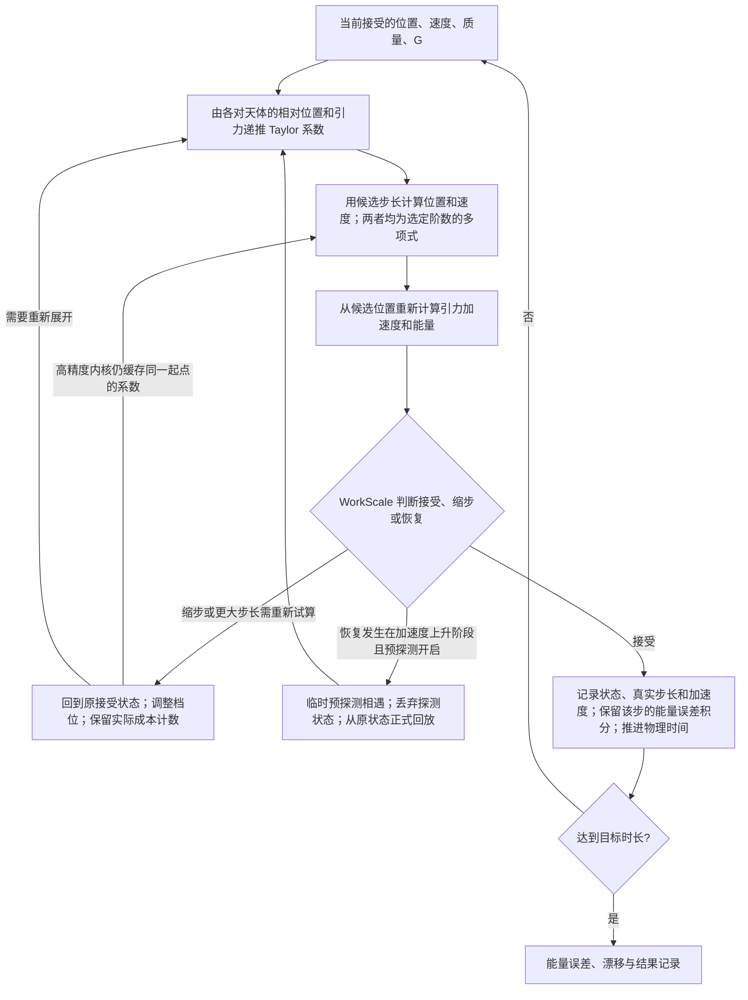

# Taylor45 / Taylor100 / Taylor150 / Taylor200

重新打开 `N body simulation Lab.py`，在 Integrator 中选择 Taylor45、100、150 或 200，再在设备栏选择工作精度。主窗口和 Test mode 的批量计划都支持这四种阶数。旧的积分器编号保留，Taylor100/150/200 分别使用编号 5/6/7。

| 设备 | 计算方式和用途 |
|---|---|
| `CPU (float64 / single thread)` | 默认。Numba 编译的双精度内核，53 个二进制有效位。 |
| `CPU (MPFR / 34 digits)` | Python 调用已编译的 MPFR 内核，113 个二进制有效位，约 34 位十进制。适合先做参数扫描。 |
| `CPU (MPFR / 80 digits)` | 同一内核，269 个二进制有效位，与原 Python 80 位工作精度一致。适合复核精度敏感的结果。 |
| `CPU (mpmath / 80 digits)` | 使用 Python 编写的 Taylor 递推，旧的 80 位计划也走这条路径。可用作独立实现对照。 |

四种选择均为单线程 CPU。Windows x64 版随 `nbody_taylor_mpfr.dll` 提供，平时直接启动 Python 主程序，不需要安装 C++ 编译器。DLL 与 `nbody_taylor_mpfr.py` 放在主程序同一目录。若修改了 `nbody_taylor_mpfr.cpp`，先关闭正在使用 DLL 的 Lab，再用本机 MSYS2 UCRT64 的编译器和 MPFR/GMP 开发库重新构建。例如在代码目录的 PowerShell 中运行 `.\build_taylor_mpfr.ps1 -Compiler 'D:\msys64\ucrt64\bin\g++.exe'`。DLL 已静态包含 MPFR/GMP；其他操作系统可使用已有的 Python/mpmath 路径。

开启 `Enable adaptive time step` 后，可选择 Time Scale Method、Acceleration Ratio 或 WorkScale 系列控制器。WorkScale 的倍率 N、最大档位 K、阈值 Q 和预探测（Pre-probe）沿用现有界面。关闭自适应后为固定步长积分。

## 状态和控制流程

已知量：当前接受的位置、速度、质量、G 和选定阶数。WorkScale 另保留接受步的加速度和实际步长历史。下图中的试算尚未成为正式轨迹，拒步不改变接受历史。

关闭 WorkScale 时按固定步长或所选其他控制器推进。Predicted 的历史步长比、预探测和恢复额度仍由主程序原有控制器管理。新内核未另造一套 WorkScale。

## 数值范围和记录

- 原有 Taylor45 float64 内核不变。新增三种 float64 阶数使用时间缩放，减轻高阶系数溢出；计算仍全程为 IEEE float64。缩放不改变物理时间单位或积分阶数。
- 位置和速度均保留到 p 次；速度使用额外的位置系数 p+1，不能将速度截成 p−1 次。
- 新阶数启用 WorkScale 时，若候选多项式求值或其诊断产生非有限值，回退到同一接受状态，缩一档重试；到 K 仍非有限则停止。系数生成本身溢出会单独报错，不能假定减小 dt 必然解决。
- 高精度内核直接从内部位置和速度计算动能、引力势能。每个接受步保留端点能量与初始能量之差，按两端误差之间的线性插值积分平方误差，并按物理时长计算 RMSE。NRMSE 再除以初始动能与引力势能绝对值之和，是无量纲量。截止于相同物理时刻后，可用 NRMSE 比较步长控制器的能量守恒表现。
- 结果图标题同时标出 `Internal MPFR`（或 `Internal mpmath`）和 `float64 snapshot NRMSE`。普通曲线、控制器输入、历史表的 `E_nRMSE` 延用双精度快照。高精度 RMSE 和 NRMSE 以十进制字符串保存在历史 JSON 的 `taylor_report` 内，键名分别为 `taylor_internal_energy_rmse` 和 `taylor_internal_energy_nrmse`。Lab 初态和候选步长以双精度传入，高精度轨道随后在内核中持续推进。工作位数描述每次数值运算的有效位数，实际轨道误差还取决于积分阶数和步长。
- `taylor_trial_evaluations` 记录完成内核求值的试算，随后被控制器丢弃的候选和预探也计入。高精度后端另存 `taylor_coefficient_generations`。一个起点多次改步长只需重新求值，通常可以少做几次昂贵的系数递推。计时范围、非有限拒步和所用后端也在元数据中。旧 `taylor45_report` 字段继续兼容 45 阶。
- 更高阶、更小 Q 和更大 K 均不保证误差更小或速度更快。此修改是功能接入；性能结论仍需相同条件、相近精度的对照实验。

Python 依赖文件使用 `requirements-taylor45.txt`。高精度后端的对照脚本、结果与修改前备份在项目 `Codex/2026-11-08-lab-mpfr/`。
