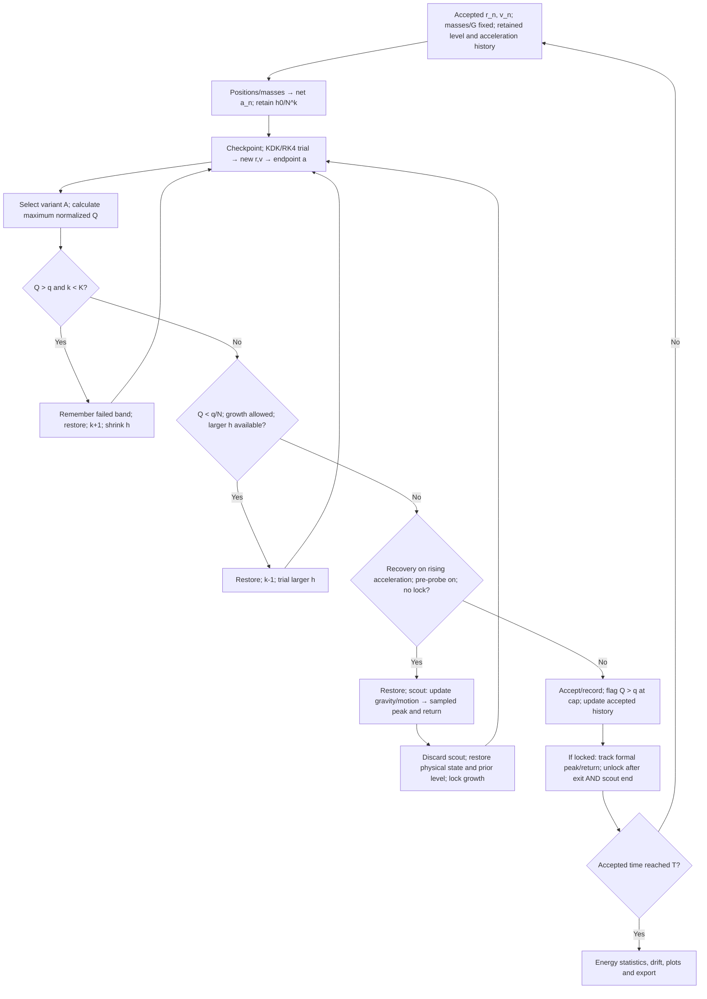

# Adaptive time stepping and Work scale

Updated 2026-11-02. [中文说明](work-scale-zh.md) · [Energy/drift/cost results](reports/2026-11-02-work-scale/README.md).

The project is currently comparing **Original, Align, Average and Predicted**, rather than declaring one universal winner. Work scale (earlier called Work skill) is an experimental global-step controller around KDK or classical RK4. All particles advance to the same accepted physical time. Gravity and the underlying integrators remain unchanged.

## Physical inputs and dependence

Known at accepted time t_n: masses m_i, positions r_i,n, velocities v_i,n, and net gravitational accelerations a_i,n. Fixed parameters are G=1, end time T, initial/maximum step h0, shrink factor N>1, integer level cap K and dimensionless threshold q. Predicted additionally uses the preceding accepted acceleration a_i,n-1. There is no softening, collision treatment or external field; units are computational units.

Positions and masses determine mutual gravity. A KDK/RK4 trial of duration h updates positions and velocities with the method's intermediate force evaluations. Trial positions determine the endpoint acceleration. The controller then selects an effective acceleration and tests the step. Only an accepted state becomes the starting data for the next physical-time update. Retrying is an inner calculation at the same starting time, not another physical-time advance.

## Shared normalized indicator

$$Q_i=\frac{m_i}{S_E}\left(|\mathbf A_i\cdot\mathbf v_{i,n}|h+\frac12|\mathbf A_i|^2h^2\right),\qquad Q=\max_iQ_i,$$

$$S_E=E_{\rm kin}(0)+|E_{\rm pot}(0)|.$$

Here i indexes particles, n indexes the accepted start, A_i is the chosen acceleration vector, v_i,n is always the **starting velocity**, and h is the actual attempted duration, including final-time clipping. The dot is a scalar product; |A| is its Euclidean norm. Mass, acceleration, velocity, h and energy have units M, L/time², L/time, time and ML²/time². Both contributions multiplied by m_i have energy units. Dividing by the positive, fixed initial scale S_E makes Q dimensionless and avoids dividing by nearly cancelled total energy.

The intuitive displacement estimate is v_start h + A h²/2. The implementation takes the magnitude of the projected linear contribution and **adds** the positive quadratic contribution; it does not take the magnitude after adding signed terms. The quadratic term remains when A dot v_start vanishes.

Q is a per-particle **energy-exchange scale**, not exact signed work, conserved-total-energy error, or an embedded truncation-error estimate. Threshold 0.01 does not mean 1% true energy error. Changing inertial frame changes velocities and normalization; dimensionless does not mean frame invariant.

## Four acceleration choices

| Method / plan identifier | Effective acceleration A_i | Data used |
|---|---|---|
| Original / `work_step` | a_i,trial | End acceleration with starting velocity |
| Align / `work_step_align` | a_i,n | Starting acceleration with starting velocity |
| Average / `work_step_average` | (a_i,n + a_i,trial)/2 | Arithmetic mean of endpoint vectors with starting velocity |
| Predicted / `work_step_predicted` | a_i,n + (a_i,n − a_i,n-1)/2 | Two accepted accelerations with starting velocity |

The same A_i is used in **both** Q terms. Average is neither an average of magnitudes nor an average of indicators; opposing endpoint vectors can cancel. Predicted uses **2.5** when previous=1 and current=2, with no additional average to 2.25. It ignores trial-end acceleration in Q and falls back to current acceleration on the first step. It does not scale the difference by the ratio of old/new time steps, so it is not a general variable-step derivative extrapolation. Rejected trials never enter its history. Actual force evaluations inside KDK/RK4 remain unchanged.

## Rejection, recovery and cap

Nominal bands are h_k=h0/N^k, with 0≤k≤K. k is retained between accepted steps; N is the step factor, not particle count. The nominal floor is h0/N^K. A final step can be shortened to land on T.

1. Checkpoint the accepted physical state and force/diagnostic caches. Trial the retained band and calculate Q.
2. If Q>q and k<K, restore the checkpoint, increase k and retry at h/N. Remember failed levels for this starting time to avoid repeatedly recovering to an already failed band.
3. If Q<q/N and k>0, restore the same start and try one larger band, unless an encounter lock or failed-band record blocks growth. Re-evaluate Q at that larger trial. Equality does not trigger growth. Final-time clipping must actually permit a larger h.
4. Accept when no retry is needed. If Q>q at k=K, **accept and flag** the exception. The cap bounds work; q is not a hard guarantee for every accepted step. Non-finite states still stop the run.
5. Record accepted time, h, positions, velocities, accelerations and energy. Rejected and disposable probe states are excluded. Accepted positions/history feed the next force and indicator calculations.

## Encounter Pre-probe

The author's diagnostic problem was unexpected step recovery around a strong-acceleration encounter. Plotting acceleration, velocity projections, Q and dt together exposed how sampled geometry and a small indicator could allow recovery too early. A continuous peak need not coincide with a recorded sample. In a general N-body system, maximum acceleration does not imply zero velocity projected onto that acceleration.

Pre-probe is an optional **encounter recovery guard**, not an energy correction:

1. A candidate would be accepted at a larger band than the level at the beginning of the current outer step. The sampled global maximum acceleration magnitude is rising into or across that trial. If no lock exists, scout ahead.
2. Restore the starting checkpoint. Run a disposable pass at the proposed larger h, measuring Q but ignoring its rejection rule. Track max_i |a_i| until a sampled peak has passed and the magnitude returns to/below its entry value, or until T/numerical failure ends scouting. This is not an exact continuous-peak locator.
3. Discard scout states and restore the checkpoint again. Restore the **pre-recovery level**, then replay formally. Shrink/rejection remains available, but an encounter lock blocks growth. Replay therefore need not have one constant step size.
4. Track the formal replay's own peak/exit. Unlock only after both reaching the scout's end time and passing the formal peak/return condition; reaching T ends the run normally. Scout and replay can follow different sampled paths.

Predicted's scout maintains its own two-state history initialized from accepted history. Temporary accelerations never enter formal history. Retries and scouting restore physical state and caches. Probe calls and rejected attempts count toward cost.

## Results and applicability

The target is deterministic close encounters and rapidly changing motion. Large acceleration alone does not establish large integration error. In the eight active cases, all four methods with pre-probe lowered energy RMS relative to the fixed run at the **same initial dt**. For RK4 they also lowered the magnitude of the finite-time fitted energy slope in all eight cases. For KDK energy improvements often accompanied larger fitted drift. These are findings for the tested settings, not all N-body initial conditions.

Concentrating small steps around encounters can avoid paying for the smallest step everywhere. However, these runs do **not** establish a general equal-accuracy runtime advantage. Adaptive runs include additional steps, retries and scouting, and are usually slower than the coarse fixed baseline. The next comparison is error versus measured cost while scanning fixed dt and adaptive settings.

Fixed-step KDK's time symmetry cannot simply be assigned to the whole state-dependent controller. Acceptance, recovery, history and locks are directional; averaging endpoint acceleration alone does not make these decisions reversible. Pre-probe does not restore a proven symmetric/symplectic adaptive scheme or guarantee bounded long-time energy error. RK4's much smaller measured error and slope are encouraging, but do not establish elimination of drift for arbitrary problems/durations.

No variant consistently won against all the others. Predicted improves some RK4 cases and worsens others, and remains experimental. The Goggles ten-period KDK/Average test also shows that better energy conservation need not recover the original periodic shape. See [settings, ratios, counterexamples and source snapshots](reports/2026-11-02-work-scale/README.md).

## Other controllers and compatibility

| Mode | Control |
|---|---|
| Fixed | h0, shortened only at T |
| Time-scale / `timescale` | Minimum pairwise gravity/flyby time × eta, capped at h0 with growth limit |
| Acceleration ratio / `acceleration_ratio` | Retained per-particle acceleration-reference bands; use the smallest global step |
| Four Work scale modes | Shared dimensionless q, N/K, rollback/recovery and optional pre-probe |

Pairwise timescale candidates are sqrt(r³/[G(m_i+m_j)]) and r/u for relative speed u>0. Both have time units. Timescale mode limits growth to 1.25 times its previous proposal and can clip at diagnostic time boundaries. Acceleration ratio retains per-particle references, caps the global exponent at K, and has no Work scale rejection rule.

Earlier `energy_ratio`, Work scale Test, Test align and Wide Protection cannot start new runs. Historical readers retain their identifiers. The dimensional endpoint a dot v controller in the October 20 history is distinct from today's mass-weighted normalized two-term definition; old records are not reinterpreted as current-formula measurements.

The author proposed the questions, variants, debugging judgments and experimental choices. KDK/RK4 and gravity are established methods; implementation/testing are AI-assisted. This repository does not claim a proven novel integrator or an astrophysical discovery.
