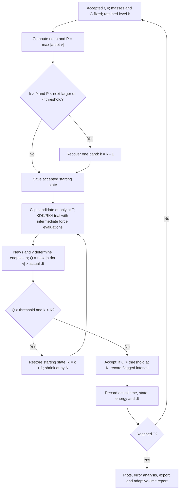

# Adaptive time stepping

This application uses global steps: all particles advance to the same accepted physical time. KDK and classical RK4 remain the underlying integrators. The controllers below choose or retry the step; they do not change Newtonian gravity, add softening, or introduce individual-particle stepping.

Inputs are current positions r_i, velocities v_i, masses m_i, G=1 in code units, the initial/maximum step h0, and the selected controller settings. Pairwise positions and masses determine net accelerations a_i. The integrator evaluates intermediate states as required, then produces a candidate position and velocity for every particle. Updated positions determine the endpoint accelerations. The simulation ends at the requested code time T; the final step may be shortened to reach T exactly.

## Experimental acceleration–velocity–step controller

UI name: **Acceleration × velocity × dt**. Plan code: `work_step`.

The project author's question behind this controller was whether motion-related information could guide step selection beyond acceleration magnitude alone. The implemented experiment monitors a velocity projection and tests candidate states before accepting them. Its usefulness must be assessed against position error, conservation error and actual runtime together; introducing a controller alone is not evidence of improved accuracy or efficiency.

For each trial ending at t+h, calculate

$$Q_i = |\mathbf a_i(t+h)\cdot\mathbf v_i(t+h)|\,h,\qquad Q=\max_i Q_i.$$

Here i identifies a particle; a_i is its total gravitational acceleration (code L/T²), v_i its velocity (code L/T), the dot denotes a scalar product, and h is the actual attempted step (code T), including any final-time clipping. Q has code L²/T² units. The threshold q_max has those same units; its default is 1 and it is adjustable through **Work trigger threshold** (`work_threshold`). It is not a percentage.

The factor |a dot v| is equivalently acceleration magnitude times the magnitude of velocity projected onto acceleration. In the continuous equations, a dot v is the rate of change of a particle's specific kinetic energy. Multiplication by h is an endpoint-based indicator, not an exact integral over the step. No mass is included. In particular, this quantity is not the error in the system's total energy: kinetic and potential energy can exchange while total energy remains constant.

Step bands are h_k = h0 / N^k, with 0 <= k <= K. N (`work_step_factor`, default 2) must exceed 1; K (`work_max_power`, default 7) is a positive integer. k is retained between accepted steps, so h0/N^K is a cumulative lower bound on the nominal step, not a per-step retry counter.

1. **Possible recovery:** At the current accepted state, compute P = max_i |a_i dot v_i|. If k>0 and P times the next larger nominal step h_(k-1) is strictly below q_max, propose recovery by one band. Equality does not trigger recovery. The proposal never exceeds h0.
2. **Trial:** Preserve the complete accepted state and diagnostic caches. Advance all particles with KDK or RK4 using the candidate step. Evaluate Q at the completed trial endpoint.
3. **Accept or shrink:** Accept Q <= q_max. If Q > q_max and k<K, restore the starting state, increase k by one, divide the nominal step by N, and retry. Rejected trials do not enter trajectory, velocity, energy, time or error-analysis records.
4. **Cap behavior:** If Q > q_max at k=K, accept the step and continue at the capped band. Record the exception. This is deliberately a bounded-cost policy; the threshold is not a hard guarantee on every accepted step.
5. **Record and repeat:** Save the accepted state, actual h and accumulated time. Diagnostics are sampled by accepted step count, plus the final state. Before the next trial, evaluate recovery from the newly accepted state.

Red shading denotes accepted step intervals classified as over-threshold by their endpoint Q. It does not assert that Q was measured continuously throughout each shaded interval. Consecutive exceptions are grouped in **Adaptive limit report**, with times, steps, particle indices, peak indicator and level. NPZ metadata and JSON exports retain the controller settings and exception records. Cancellation is checked between attempts. Singular/non-finite states still stop the run; the K-cap policy does not make an undefined force acceptable.

## Other available controllers

| Mode | Main parameter | K slot | Decision |
|---|---|---|---|
| Fixed step | Initial dt | Not applicable | Keep h0; shorten only the final step |
| Time-scale method (`timescale`) | Safety factor eta | Disabled | Minimum pairwise gravity/flyby timescale, scaled by eta |
| Acceleration ratio (`acceleration_ratio`) | Acceleration multiplier N | Maximum cumulative exponent K | Per-star acceleration/reference power bands; choose the smallest global step |
| Acceleration × velocity × dt (`work_step`) | Shrink/recovery factor N | Maximum cumulative exponent K | Trial-end Q test, rollback, recovery and flagged cap exceptions |

The shared parameter slot preserves each controller's settings. Work-step also has its separate dimensional threshold field. An old plan selecting `energy_ratio` is rejected explicitly; it is not silently remapped to another controller. Historical EnergyRatio result labels are retained only for reading past records.

### Pairwise timescale method

For pair separation r, relative speed u, and mu=G(m_i+m_j), the pairwise candidates are sqrt(r³/mu) and r/u when u>0. r has length units, u length/time, and mu length³/time², so both candidates are times. The controller takes the smallest eta-scaled candidate over all pairs and caps it at h0. The previous proposal additionally limits growth to 1.25 times its previous value. Diagnostic physical-time boundaries can shorten an accepted step in this mode. A very small required step triggers the existing safety stop; this mode does not use the discrete N/K bands.

### Acceleration-ratio method

Each particle retains an acceleration-magnitude reference initialized from its initial net acceleration. A zero initial magnitude uses the system's initial nonzero scale; an all-zero initial state initializes references when nonzero acceleration first appears. The reference changes with that particle's discrete level, rather than being replaced after every tiny step. A ratio strictly above N triggers a higher power band; exact higher powers enter their own bands. Decreasing acceleration can recover bands. The global level is the largest per-particle level, capped at K, and dt = h0/N^level. The cap remains relative to h0 throughout the run. This is a heuristic based on known acceleration, without trial rejection; it is not a local truncation-error estimator.

## Interpretation and validation

- Large acceleration or large Q does not by itself establish a large integration error. Turning-point geometry can make a dot v small even while acceleration is substantial. This criterion does not resolve all close-encounter failure modes.
- Q and its threshold depend on the code-unit convention and on velocities in the chosen inertial frame. They are not a universal, dimensionless tolerance transferable unchanged between rescaled or boosted problems.
- State-dependent adaptive KDK should not automatically be attributed all long-time geometric properties of fixed-step leapfrog. Evaluate the actual implemented scheme.
- Compare equal physical durations and initial conditions. Use analytic or independently checked references where available, and compare position errors and energy errors at matched cost. Conservation alone does not certify a trajectory.
- The release regression compares retained modes before/after removal of EnergyRatio, checks all four compute backends, exercises rollback and cap reporting, and verifies main/batch settings and portable exports. See [machine-readable release checks](reports/work-step-release-checks.json). These checks establish implementation behavior for the tested cases, not universal stability or superiority.

The integrators and pairwise timescale concepts are established numerical methods. The work-step controller is an experimental project choice developed from the author's questions, with AI-assisted implementation and testing; this repository does not claim it is a newly proven or uniquely original numerical method.
