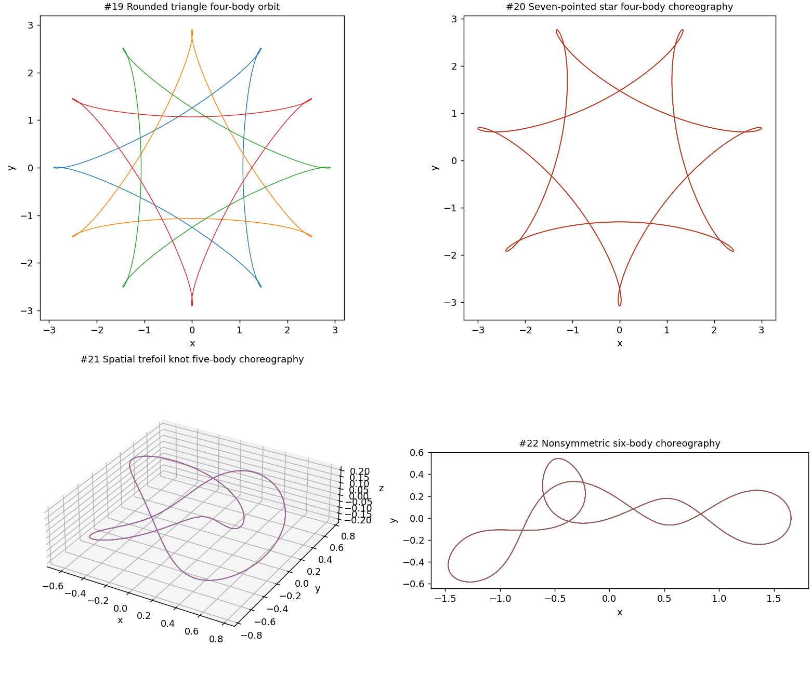

# Expanded periodic-orbit catalog

The interactive application now offers **22 entries** (21 in the shared catalog plus its historical unequal-mass free-fall case). Previous entries retain their indices, so old batch plans continue to select the same orbit.

| Interactive menu | New shape | Provenance / interpretation |
|---|---|---|
| 19 | Four separate rounded triangular loops | Ouyang-Xie, theta=5*pi/12; reported planar linear stability; printed initial values retained |
| 20 | Four-body seven-pointed star | Ouyang-Xie, theta=3*pi/7; reported planar linear stability; printed initial values retained |
| 21 | Five-body spatial trefoil knot | Calleja et al.; proved periodic existence; explicitly unstable |
| 22 | Nonsymmetric six-body choreography | Kapela-Simo; periodic existence, not a stability theorem for this orbit; numerically refined initial data |

These join the spatial three-body orbit, four-body pentagram, and five-/six-body chain examples added before this final set. The label 'known orbit' does not mean every entry is stable or an analytic trajectory.

All four new entries use G=1, unit masses and unsoftened Newtonian gravity, with one-period RK4 defaults. Actual local dictionary-CPU runs gave maximum individual-body return distances approximately 0.00189, 0.00854, 4.96e-8 and 1.26e-5 respectively. See [verification](verification.json). These checks establish finite-time reproduction, not long-term stability.

The first two return differences persist with tight independent integration because the published parameters are rounded. They must not be treated as exact reference trajectories.

The trefoil uses all 25 nonnegative [published Fourier modes](trefoil_fourier_table1.txt), with conjugate negative modes. Positions and velocities are converted from the rotating frame, including the rotational velocity term. Its physical period is 6*pi/omega = 5.355627818278749, where omega=3*sqrt(s1); the normalized 6*pi period does not apply directly to the G=1 initial state.

For the nonsymmetric six-body orbit, Table 3's rounded values are expanded using y1=vx1=0 and zero center of mass/momentum. A numerical shooting correction imposes the T/6 choreography condition at T=2*pi. The largest parameter correction is 9.48e-9. [Original and refined values](six_body_refinement.json) are both retained. Refined digits are locally computed, not extra published precision. [Independent checks](independent_checks.json) describe the rounded six-body state before correction, not the final default.

Sources: [Ouyang-Xie](https://arxiv.org/pdf/1306.0119), [Calleja et al.](https://arxiv.org/pdf/1901.03738), [Kapela-Simo](https://ww2.ii.uj.edu.pl/~kapela/papers/nosym.pdf). Full parameter provenance and cautions are also embedded in `stable_orbits.py`.
