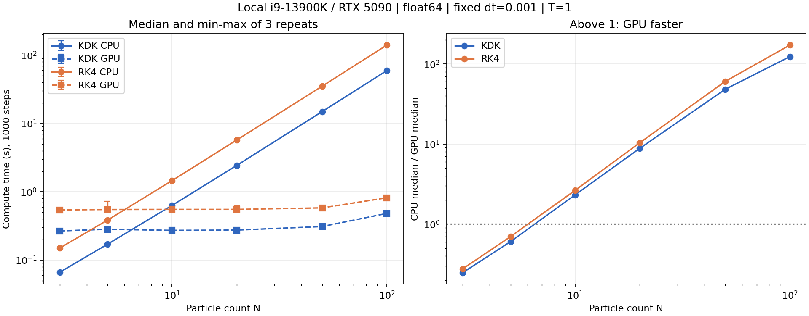
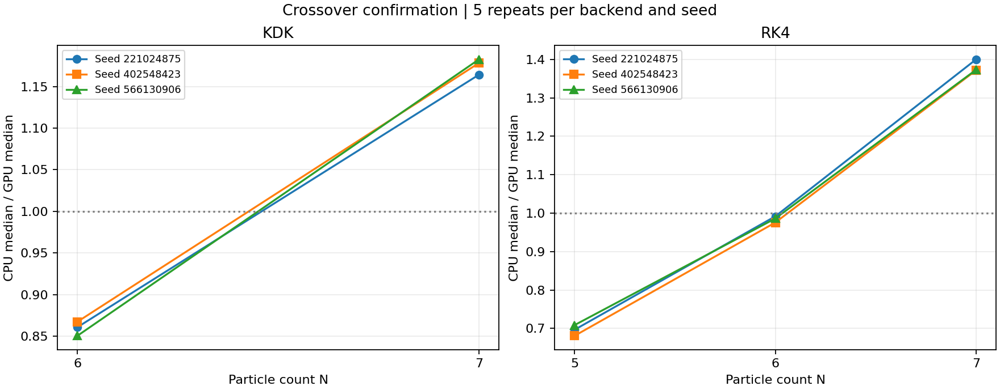

# Historical CPU/GPU crossover results

This 2026-10-07 round compares the original dictionary CPU with CUDA. For the compiled CPU backends and the newer workload, see the [2026-10-20 retest](../2026-10-20-backends/README.md).

Completed: 2026-10-07T23:00:13.998249-04:00

## Findings

- KDK: all three seed-specific confirmation medians favor CPU at N=6 and GPU at N=7. The measured crossover is bracketed by 6 and 7 for this workload.
- RK4: N=5 favors CPU; N=6 is near a tie with overlapping repeat ranges (pooled median GPU/CPU timings differ by only about 1.4%); N=7 favors GPU in all three seed-specific medians. Treat N=6 as a transition region, not a robust choice of winner.
- At N=100 the coarse-scan median speedups are about 123x for KDK and 172x for RK4. These large ratios include the cost of the existing serial Python CPU implementation; they are not intrinsic CPU/GPU hardware ratios.
- This finding applies to warmed float64 runs of 1000 fixed steps with the stated recording policy. Different particle counts, recording costs, implementation, adaptive steps, hardware or system load can move the crossover.

## Hardware and scope

- CPU: 13th Gen Intel(R) Core(TM) i9-13900K.
- GPU: NVIDIA GeForce RTX 5090.
- Python: 3.14.3 (tags/v3.14.3:323c59a, Feb  3 2026, 16:04:56) [MSC v.1944 64 bit (AMD64)]; NumPy 2.4.3; CuPy 14.2.0.
- CUDA runtime API version: 13020; driver API compatibility version: 13030.
- Existing CPU Python pair-loop and GPU CuPy RawKernel implementations, run on the user's local computer. This is not a hardware-independent crossover or an optimized compiled-CPU comparison.
- Fixed dt=0.001, T=1, 1000 steps, float64, G=1, no adaptive stepping; diagnostics every 10 steps. All trajectories retained.
- Primary cost: existing Compute_time_s. Initialization, plotting and export are outside it; per-step CPU diagnostics and GPU-to-host transfers are included. Synchronized outer call time is additionally recorded.
- Each group has two 20-step warm-ups per backend. CPU/GPU pair order alternates by repeat. All group timings finish before plots are rendered.
- Each CPU/GPU pair uses identical initial arrays; arrays and SHA256 identities are saved. Three repeats per coarse point; five per refinement/confirmation point; confirmation covers three fixed seeds.
- Twelve short pilot pairs checked finite states, separation and backend agreement before the scan. Pilot/warm-up runs are excluded from the measured history.
- The random box has fixed size and unit particle masses, so N changes density and total mass. This tests implementation cost, not physical convergence.
- CPU reference labels denote a backend-agreement baseline, not exact trajectories. Short, weakly evolving random systems do not establish long-time or close-encounter equivalence.

## Coarse scan

| Method | N | CPU median (s) | GPU median (s) | Speedup | runs.dat lines |
|---|---:|---:|---:|---:|---|
| KDK | 3 | 0.066417 | 0.267302 | 0.248 | 122-127 |
| KDK | 5 | 0.170627 | 0.282633 | 0.604 | 128-133 |
| KDK | 10 | 0.631911 | 0.272397 | 2.320 | 134-139 |
| KDK | 20 | 2.429174 | 0.275046 | 8.832 | 140-145 |
| KDK | 50 | 14.947990 | 0.310003 | 48.219 | 146-151 |
| KDK | 100 | 59.465650 | 0.482077 | 123.353 | 152-157 |
| RK4 | 3 | 0.150243 | 0.541951 | 0.277 | 158-163 |
| RK4 | 5 | 0.383886 | 0.550456 | 0.697 | 164-169 |
| RK4 | 10 | 1.459509 | 0.552345 | 2.642 | 170-175 |
| RK4 | 20 | 5.731798 | 0.552467 | 10.375 | 176-181 |
| RK4 | 50 | 35.175099 | 0.581633 | 60.476 | 182-187 |
| RK4 | 100 | 140.280150 | 0.816942 | 171.714 | 188-193 |

## Refined crossover confirmation

| Method | N | CPU median (s) | GPU median (s) | Speedup | Seed median speedups |
|---|---:|---:|---:|---:|---|
| KDK | 6 | 0.239653 | 0.279153 | 0.859 | 0.861, 0.867, 0.850 |
| KDK | 7 | 0.317646 | 0.270775 | 1.173 | 1.164, 1.178, 1.183 |
| RK4 | 5 | 0.388690 | 0.551951 | 0.704 | 0.696, 0.681, 0.709 |
| RK4 | 6 | 0.550400 | 0.558219 | 0.986 | 0.992, 0.976, 0.986 |
| RK4 | 7 | 0.727865 | 0.529372 | 1.375 | 1.400, 1.372, 1.373 |

A crossover is a measured interval, not an exact hardware constant. Compare seed-specific medians and raw repeat ranges in analysis_results.json; small differences near 1 are sensitive to scheduling and GPU clock state.

## Numerical and archival checks

- Measured runs: 262; history lines 122-383.
- Maximum position NRMSE against each group's first CPU trajectory: 0.000000e+00.
- Maximum pointwise 3D position difference: 0.000000e+00; velocity difference: 2.860979e-17 (code units).
- Maximum recorded energy NRMSE: 7.484689e-12; maximum normalized energy excursion: 1.591579e-11.
- Original 103 run summaries were backed up and migrated to a Device_model column. Original numerical values and line numbers are preserved. Historical models are based on the user's confirmation that all old runs used this computer; new models are queried at runtime.
- Every measured run has a PNG, NPZ, immutable summary, batch configuration and comparison record in the existing archive. CPU/GPU runs with the same N/seed/method are compared; different N values never share a trajectory reference.

## All groups and data locations

| Phase | Method | N | Seed | Repeats/backend | runs.dat lines | Plan |
|---|---|---:|---:|---:|---|---|
| coarse | KDK | 3 | 221024875 | 3 | 122-127 | [coarse_method1_N3_seed221024875_r3](coarse_method1_N3_seed221024875_r3_plan.json) |
| coarse | KDK | 5 | 221024875 | 3 | 128-133 | [coarse_method1_N5_seed221024875_r3](coarse_method1_N5_seed221024875_r3_plan.json) |
| coarse | KDK | 10 | 221024875 | 3 | 134-139 | [coarse_method1_N10_seed221024875_r3](coarse_method1_N10_seed221024875_r3_plan.json) |
| coarse | KDK | 20 | 221024875 | 3 | 140-145 | [coarse_method1_N20_seed221024875_r3](coarse_method1_N20_seed221024875_r3_plan.json) |
| coarse | KDK | 50 | 221024875 | 3 | 146-151 | [coarse_method1_N50_seed221024875_r3](coarse_method1_N50_seed221024875_r3_plan.json) |
| coarse | KDK | 100 | 221024875 | 3 | 152-157 | [coarse_method1_N100_seed221024875_r3](coarse_method1_N100_seed221024875_r3_plan.json) |
| coarse | RK4 | 3 | 221024875 | 3 | 158-163 | [coarse_method2_N3_seed221024875_r3](coarse_method2_N3_seed221024875_r3_plan.json) |
| coarse | RK4 | 5 | 221024875 | 3 | 164-169 | [coarse_method2_N5_seed221024875_r3](coarse_method2_N5_seed221024875_r3_plan.json) |
| coarse | RK4 | 10 | 221024875 | 3 | 170-175 | [coarse_method2_N10_seed221024875_r3](coarse_method2_N10_seed221024875_r3_plan.json) |
| coarse | RK4 | 20 | 221024875 | 3 | 176-181 | [coarse_method2_N20_seed221024875_r3](coarse_method2_N20_seed221024875_r3_plan.json) |
| coarse | RK4 | 50 | 221024875 | 3 | 182-187 | [coarse_method2_N50_seed221024875_r3](coarse_method2_N50_seed221024875_r3_plan.json) |
| coarse | RK4 | 100 | 221024875 | 3 | 188-193 | [coarse_method2_N100_seed221024875_r3](coarse_method2_N100_seed221024875_r3_plan.json) |
| refine | KDK | 7 | 221024875 | 5 | 194-203 | [refine_method1_N7_seed221024875_r5](refine_method1_N7_seed221024875_r5_plan.json) |
| refine | KDK | 6 | 221024875 | 5 | 204-213 | [refine_method1_N6_seed221024875_r5](refine_method1_N6_seed221024875_r5_plan.json) |
| confirm | KDK | 6 | 221024875 | 5 | 214-223 | [confirm_method1_N6_seed221024875_r5](confirm_method1_N6_seed221024875_r5_plan.json) |
| confirm | KDK | 6 | 402548423 | 5 | 224-233 | [confirm_method1_N6_seed402548423_r5](confirm_method1_N6_seed402548423_r5_plan.json) |
| confirm | KDK | 6 | 566130906 | 5 | 234-243 | [confirm_method1_N6_seed566130906_r5](confirm_method1_N6_seed566130906_r5_plan.json) |
| confirm | KDK | 7 | 221024875 | 5 | 244-253 | [confirm_method1_N7_seed221024875_r5](confirm_method1_N7_seed221024875_r5_plan.json) |
| confirm | KDK | 7 | 402548423 | 5 | 254-263 | [confirm_method1_N7_seed402548423_r5](confirm_method1_N7_seed402548423_r5_plan.json) |
| confirm | KDK | 7 | 566130906 | 5 | 264-273 | [confirm_method1_N7_seed566130906_r5](confirm_method1_N7_seed566130906_r5_plan.json) |
| refine | RK4 | 7 | 221024875 | 5 | 274-283 | [refine_method2_N7_seed221024875_r5](refine_method2_N7_seed221024875_r5_plan.json) |
| refine | RK4 | 6 | 221024875 | 5 | 284-293 | [refine_method2_N6_seed221024875_r5](refine_method2_N6_seed221024875_r5_plan.json) |
| confirm | RK4 | 5 | 221024875 | 5 | 294-303 | [confirm_method2_N5_seed221024875_r5](confirm_method2_N5_seed221024875_r5_plan.json) |
| confirm | RK4 | 5 | 402548423 | 5 | 304-313 | [confirm_method2_N5_seed402548423_r5](confirm_method2_N5_seed402548423_r5_plan.json) |
| confirm | RK4 | 5 | 566130906 | 5 | 314-323 | [confirm_method2_N5_seed566130906_r5](confirm_method2_N5_seed566130906_r5_plan.json) |
| confirm | RK4 | 6 | 221024875 | 5 | 324-333 | [confirm_method2_N6_seed221024875_r5](confirm_method2_N6_seed221024875_r5_plan.json) |
| confirm | RK4 | 6 | 402548423 | 5 | 334-343 | [confirm_method2_N6_seed402548423_r5](confirm_method2_N6_seed402548423_r5_plan.json) |
| confirm | RK4 | 6 | 566130906 | 5 | 344-353 | [confirm_method2_N6_seed566130906_r5](confirm_method2_N6_seed566130906_r5_plan.json) |
| confirm | RK4 | 7 | 221024875 | 5 | 354-363 | [confirm_method2_N7_seed221024875_r5](confirm_method2_N7_seed221024875_r5_plan.json) |
| confirm | RK4 | 7 | 402548423 | 5 | 364-373 | [confirm_method2_N7_seed402548423_r5](confirm_method2_N7_seed402548423_r5_plan.json) |
| confirm | RK4 | 7 | 566130906 | 5 | 374-383 | [confirm_method2_N7_seed566130906_r5](confirm_method2_N7_seed566130906_r5_plan.json) |

Machine-readable results: [analysis_results.json](analysis_results.json). Hardware: [environment.json](environment.json). Run records and linked plots: [published run history](../../../data/run-history/README.md). Full trajectory arrays and local backups are not included.
