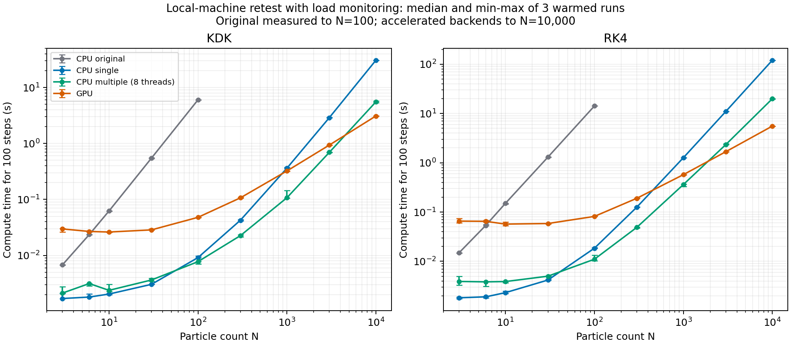
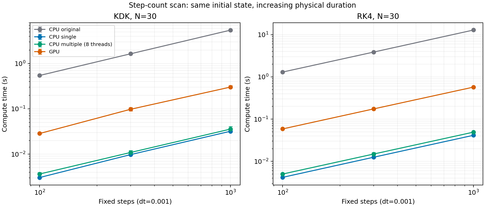
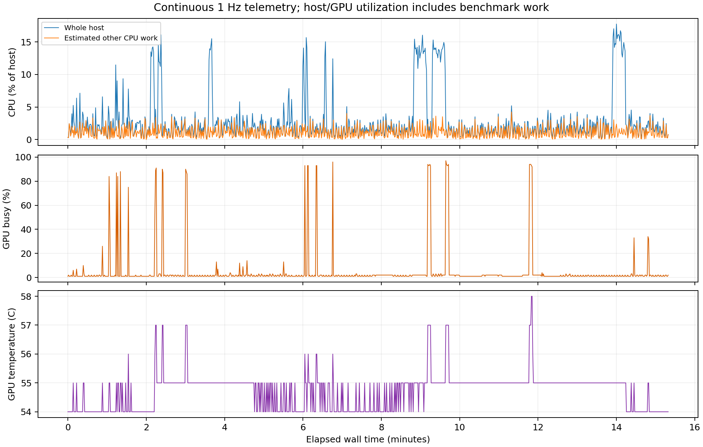

# CPU/GPU performance after CPU array optimization (2026-10-20)

The optimized CPU implementations move the GPU crossover to substantially larger particle counts than the original Python dictionary implementation. These results measure this application's integration, recording and diagnostic workload on the author's local computer; they are not hardware-only throughput measurements.

## Hardware and controls

- Intel Core i9-13900K; NVIDIA GeForce RTX 5090; Windows 11.
- Python 3.14.3, NumPy 2.4.3, Numba 0.68.0, CuPy 14.2.0; float64; G=1, fixed dt=0.001, seed=221024875, diagnostics every 10 steps.
- Dictionary CPU, Numba array single-thread, Numba array multi-thread with **8 worker threads**, and CuPy/CUDA. Worker threads are not a count of physical cores; CPU affinity was not pinned.
- 80 configurations, 3 warmed repeats each: **240 measured runs**, executed sequentially with backend order rotated. CPU/GPU initial-state hashes match within each comparison.
- Particle-count sweep: 100 integration steps, N=3,6,10,30,100 for all backends; N=300,1000,3000,10000 for the three accelerated backends. Large-N dictionary timings were not measured or extrapolated.
- Step-count sweep: N=30, 100/300/1000 steps, both KDK and RK4. At fixed dt this also changes the physical duration; it is not a time-step convergence study.
- Primary elapsed time includes integration, full trajectory recording and diagnostics. Initialization/JIT, plotting and export are excluded. A synchronized outer time, including setup and drift analysis, is also recorded.

## Sampled crossover intervals

| CPU baseline | KDK: CPU-faster / GPU-faster sampled N | RK4: CPU-faster / GPU-faster sampled N |
|---|---:|---:|
| Original dictionary CPU | 6 / 10 | 6 / 10 |
| Array single-thread CPU | 300 / 1000 | 300 / 1000 |
| Array multi-thread CPU, 8 workers | 3000 / 10000 | 1000 / 3000 |

The GPU-faster endpoint is the first faster **sampled median**, not an exact critical N. At those endpoints the observed repeat ranges do not overlap. Interior particle counts have not been refined in this round. These data do not support a rule that GPU becomes faster as soon as N exceeds the CPU core count.

## Median time for 100 steps, seconds

| Integrator | N | Dictionary CPU | Array single | Array multi (8 threads) | GPU |
|---|---:|---:|---:|---:|---:|
| KDK | 3 | 0.0067964 | 0.0016976 | 0.0021246 | 0.0297037 |
| KDK | 6 | 0.0235635 | 0.001803 | 0.003143 | 0.0267751 |
| KDK | 10 | 0.0621116 | 0.0020395 | 0.0023758 | 0.0261528 |
| KDK | 30 | 0.546436 | 0.0030413 | 0.0036371 | 0.0285468 |
| KDK | 100 | 6.00313 | 0.0091275 | 0.0077251 | 0.0478474 |
| KDK | 300 | Not measured | 0.0424793 | 0.0225448 | 0.106751 |
| KDK | 1000 | Not measured | 0.361364 | 0.107209 | 0.322302 |
| KDK | 3000 | Not measured | 2.89402 | 0.693818 | 0.935935 |
| KDK | 10000 | Not measured | 30.5737 | 5.52059 | 3.091 |
| RK4 | 3 | 0.0148399 | 0.0018209 | 0.0039074 | 0.0653964 |
| RK4 | 6 | 0.0535112 | 0.0019051 | 0.0038341 | 0.0648436 |
| RK4 | 10 | 0.150467 | 0.002317 | 0.0038893 | 0.0569488 |
| RK4 | 30 | 1.30042 | 0.0041721 | 0.0049984 | 0.0585111 |
| RK4 | 100 | 14.1829 | 0.0184671 | 0.011038 | 0.0815349 |
| RK4 | 300 | Not measured | 0.125967 | 0.048975 | 0.190398 |
| RK4 | 1000 | Not measured | 1.2652 | 0.361238 | 0.573558 |
| RK4 | 3000 | Not measured | 10.9808 | 2.33713 | 1.67508 |
| RK4 | 10000 | Not measured | 120.099 | 19.8769 | 5.54267 |

At N=100, array single-thread is approximately 658 times faster than dictionary CPU for KDK and 768 times for RK4 under this workload. This reflects removal of Python-loop overhead and compilation of the numerical loops; it is not a change in physical precision or the O(N^2) direct-gravity scaling. Multi-thread coordination can make small cases slower than the single-thread implementation.

## Step-count scaling and numerical agreement

At N=30 the fitted time-versus-step-count exponents range from 0.991 to 1.025. Runtime is approximately proportional to steps in this tested range. Cross-backend checks recorded maximum position NRMSE of zero at stored precision, maximum velocity-component difference 2.776e-17, and maximum energy difference normalized by the initial energy scale 4.541e-15. These short random-system checks do not establish bitwise equivalence in general or accuracy through long chaotic encounters.

## Load evidence and limitations

Each group waited for a four-second gate with average host CPU <=8% and maximum GPU <=10%. Observed gate CPU mean was 1.66%; GPU maximum was 7%. During measured runs the estimated background-CPU 95th percentile was 2.84%, maximum 4.24%, expressed against all logical processors. GPU temperature was 54-58 C over the monitored run.

This is evidence of low background load, not exclusive hardware use. Sampling was at 1 Hz; 162 short outer calls had no internal telemetry sample. CPU affinity and GPU clocks were not fixed. Eight configurations had repeat ranges exceeding 20% of their medians; see [verification](verification.json). Three-repeat min/max ranges are not confidence intervals. The random box and unit particle masses remain fixed as N changes, so total mass and density change; this is an implementation benchmark, not physical convergence.

## Reproduction and published evidence

- [Importable workload plan](../../../plans/cpu-gpu/2026-10-20-four-backends.json). Load it in Test mode. This reproduces configuration choices, but ordinary Test mode does not recreate the historical warm-up, load gates or profiler.
- [All 240 measured timings and initial-state hashes](benchmark_runs.csv).
- [Summary CSV](benchmark_summary.csv), [summary JSON](benchmark_summary.json), [crossover endpoints](crossovers.json), [step-count fits](benchmark_time_fits.json).
- [Design](design.json), [environment](environment.json), [verification](verification.json), [aggregate load evidence](load_summary.json).
- [Exact source snapshot used for this benchmark](source_snapshot/) and [SHA256 hashes](source_hashes.json). The current application has later catalog/plotting updates; use this snapshot when studying the historical measurements.
- [Historical 2026-10-07 dictionary/GPU study](../2026-10-07-cpu-gpu/results.md), [earlier 2026-10-19 four-backend round](../2026-10-19-backends/README.md). Do not pool their timings with this round.

Full NPZ trajectories and raw process-level telemetry are retained locally and are not included in this lightweight publication. The 240 retest measurements are in the CSV above, separate from the dated `data/run-history` snapshot.

Publication verification: [24 short local CPU/GPU smoke runs, GUI/catalog checks and data/link checks](publication_checks.json). These packaging checks are separate from the 240 historical performance measurements.
