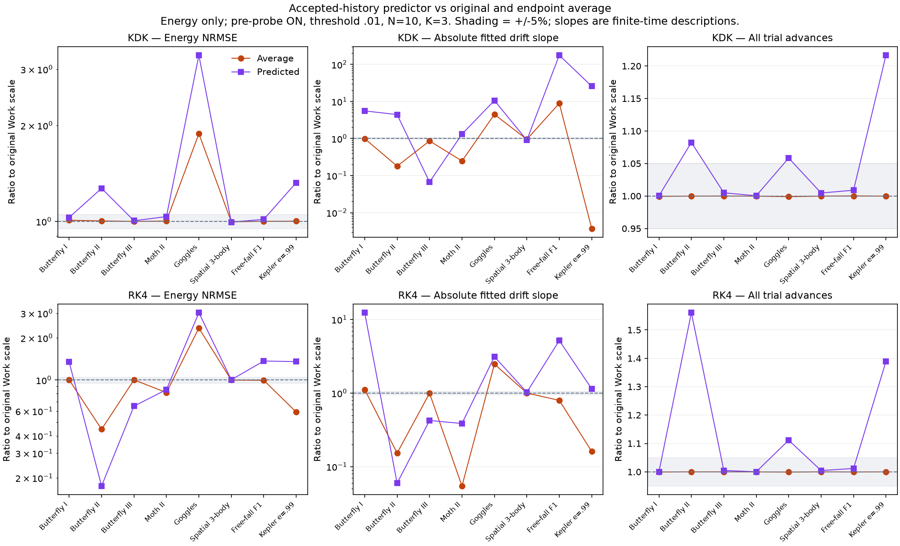
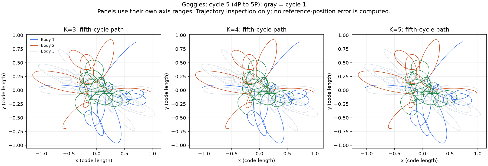
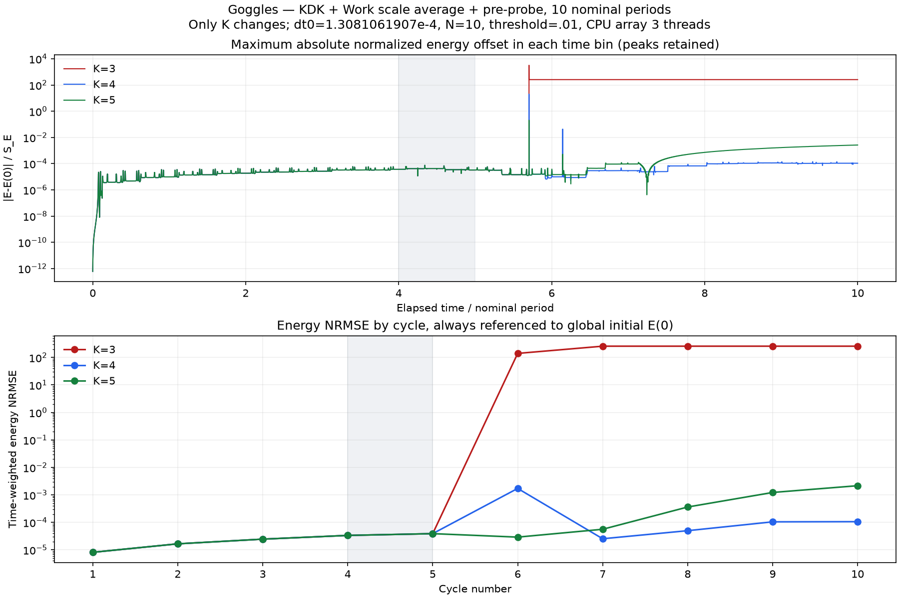

# Work scale comparison: energy, drift and cost

Published 2026-11-02. [Algorithm specification](../../adaptive-stepping.md) · [中文说明](../../work-scale-zh.md).

## Research question and scope

The author is testing whether a work-scale controller and encounter recovery guard can improve close-encounter integration, and whether Original, Align, Average or Predicted is preferable. KDK and RK4 are tested separately. The work is exploratory; counterexamples guide the next test rather than being removed from the report.

The first suite contains **96 runs**: 12 preselected deterministic cases × KDK/RK4 × fixed/Original/Align/Average. Eight cases activated adaptation: Butterfly I, II, III; Moth II; Goggles; spatial three-body O3; unequal-mass free-fall F1; and a Kepler binary at eccentricity 0.99. Four non-activating cases (Moth I, a four-body star and the five-/six-body chain cases) are retained in the results, but not counted as demonstrated benefits. Figure-eight, Lagrange and circular binaries were excluded from this encounter comparison.

The follow-up adds **16 Predicted runs**, both integrators on the same eight active cases; other results are reused. Only energy, fitted drift and cost are compared here. A separate three-run experiment uses Goggles KDK/Average for ten periods with K=3/4/5. It must not be confused with the one-period Goggles Predicted comparison.

## Controlled settings and statistics

- [configurations.json](configurations.json) contains each case's orbit index, initial dt, duration and parameters. Adaptive comparisons use pre-probe ON, dimensionless q=0.01, factor N=10, K=3, float64 CPU array single thread. The catalog specifies the masses/initial positions/velocities; the configurable binary uses e=0.99 and three periods. Other cases use their preset duration. The orbit seed field is a deterministic menu identifier, not a random realization.
- Fixed baselines use the same initial dt and physical duration. This is **not matched cost or matched accuracy**. More accepted steps/retries explain part of the improvement.
- Let deltaE_j=E(t_j)−E(0), delta t_j=t_(j+1)−t_j, and duration D=t_end−t_start. Energy RMS² is the sum of delta t_j × (deltaE_j²+deltaE_j deltaE_(j+1)+deltaE_(j+1)²)/(3D). This integrates the square of linearly interpolated energy over all accepted intervals. RMS has code-energy units; NRMSE=RMS/[initial kinetic energy + absolute initial potential energy] is dimensionless. Rejected/probe energies are excluded.
- Drift k is the slope of the all-record physical-time-weighted fit deltaE=b+k t, with free intercept b. k has energy/time units. Compare magnitudes while retaining signed values and fit R². A tiny slope or low R² alone does not certify long-time conservation.
- Wall times are single measurements including integration, recording, rejected trials and pre-probe, excluding initialization/JIT and post-run statistics. Predicted and earlier variants were timed in different batches. Small timing differences are descriptive; deterministic total trial counts are also reported. A trial is not the same number of force evaluations for KDK and RK4.

## Against the same-initial-dt fixed baseline

Counts below use a 5% descriptive band, not a statistical significance test. All four methods lower energy RMS in all eight active cases. For RK4 all four also lower absolute fitted drift. KDK often trades smaller RMS for larger drift.

| Integrator | Work variant | Energy RMS lower by >5% | Absolute fitted drift lower by >5% |
|---|---|---:|---:|
| KDK | Original | 8/8 | 3/8 |
| KDK | Align | 8/8 | 0/8 |
| KDK | Average | 8/8 | 2/8 |
| KDK | Predicted | 8/8 | 1/8 |
| RK4 | Original | 8/8 | 8/8 |
| RK4 | Align | 8/8 | 8/8 |
| RK4 | Average | 8/8 | 8/8 |
| RK4 | Predicted | 8/8 | 8/8 |

This supports the finite-time RK4 improvement as a current highlight. It does not establish a universal integrator ranking, a strict error bound, or elimination of long-time drift.

### Example: Butterfly II, RK4

These values share initial dt and duration; Predicted was timed in the follow-up batch. All adaptive variants use pre-probe.

| Method | Energy NRMSE | Signed drift k (energy/time) | Total trials | Single wall time (s) |
|---|---:|---:|---:|---:|
| Fixed | 2.781539e-04 | -2.195696e-04 | 320,000 | 5.09 |
| Original | 1.450164e-10 | -8.026316e-11 | 498,849 | 19.51 |
| Align | 9.243836e-11 | -5.215484e-11 | 498,818 | 19.42 |
| Average | 6.450287e-11 | +1.225512e-11 | 498,798 | 20.15 |
| Predicted | 2.537564e-11 | -4.782529e-12 | 778,500 | 33.59 |

Predicted lowers RMS by about 82.5% versus Original and 60.7% versus Average here, but needs about 56.1% more trials than Original. Thus even this favorable case does not establish equal-cost superiority.

## Which work-scale variant is better?

No universal winner has emerged. In the active cases, Average versus Original energy RMS is better/similar/worse in 0/7/1 KDK cases and 3/4/1 RK4 cases. Predicted versus Original is 0/5/3 for KDK and 3/1/4 for RK4; versus Average it is 0/5/3 and 2/2/4. Here “similar” means within ±5%.

For example, Goggles RK4 Predicted RMS is about 3.03 times Original and 1.29 times Average. The eccentric binary also has higher Predicted RMS despite more computation. Very large drift ratios can result from near-zero baseline slopes; inspect absolute signed values and R² in the data.

This figure has KDK/RK4 columns; rows show energy RMS ratio, absolute drift ratio and total trial ratio. The horizontal axis lists the eight deterministic cases; vertical axes are logarithmic dimensionless ratios. Smaller is better for the plotted metric. Ratios do not measure trajectory accuracy or equal-accuracy runtime.

## Goggles: raising the cap for ten periods

Only K changes. KDK + Average + pre-probe; h0=0.00013081061907, q=0.01, N=10; duration=104.648495256 (10 nominal periods); CPU array parallel, three threads; diagnostic interval=10. These are separate settings from the single-thread one-period variant comparison. The historical run did not store its diagnostic interval; the current default was used. K=3 reproduced the saved step count, energy RMS and fitted slope exactly.

| K | Energy NRMSE | Signed drift k | Wall time (s) | First accepted Q-cap exception |
|---|---:|---:|---:|---|
| 3 | 168.752336 | +9.293203 | 52.79 | t/P=4.0926, fifth cycle |
| 4 | 5.461663e-4 | +2.333202e-6 | 74.58 | t/P=5.7035, sixth cycle |
| 5 | 7.948966e-4 | −4.368976e-5 | 208.40 | t/P=5.7035, sixth cycle |

Increasing K suppressed later catastrophic energy error but **did not restore the fifth-cycle periodic shape**. K=4 and K=5 have identical saved fifth-cycle paths; all three share identical accepted time, h and energy records during the first four periods. Raising a cap cannot change steps before that cap binds. Fifth-cycle paths remain bounded (maximum sampled radius about 1.19), so loss of periodic shape is distinguished from unbounded escape. No reference-position errors are calculated here.

K=4/5 still accept 38,242/46,232 Q-cap exceptions. K=4's drift fit has R²≈0.0025, so its small fitted slope is a weak long-time summary. K=5 costs more and has larger RMS here; K=4 is not thereby a universal optimum.

## Interpretation and next work

The most promising present use is encounter resolution with RK4, evaluating energy and fitted drift over the tested finite durations. KDK's smaller excursions can accompany worse drift, and the controller has no demonstrated time-symmetry restoration. Pre-probe guards recovery; it does not correct conserved energy directly. Energy conservation alone does not certify accurate paths.

Concentrating small steps near encounters offers a possible cost advantage over a uniformly tiny fixed step. **The current data do not prove that advantage at matched accuracy.** Scan fixed dt and adaptive settings, include failed/probe work, repeat timings, and compare complete error-cost curves. Test longer durations, more encounter geometries and probe on/off before making broader claims. Averaging/extrapolation variants need their own evidence rather than being assumed improvements.

## Evidence and reproduction

- [112-run energy-only table](energy-results.csv) and [full-precision JSON](energy-results.json); [summary counts](comparison-summary.json) and [same-initial-dt cost observations](cost-observations.json). Original 96 rows and 16 follow-ups are projected without changing the source data.
- [Configurations](configurations.json), [provenance and hashes](provenance.json), [Predicted ratios](predicted-comparison.csv), [Goggles table](goggles-comparison.csv) and [full Goggles summaries](goggles-results.json).
- Exact numerical source snapshots: [Average suite](source-snapshots/average/interactive_nbody_lab.py), [Predicted follow-up](source-snapshots/predicted/interactive_nbody_lab.py). Supporting modules accompany both. Their historical export defaults are preserved; use the current app for normal operation.
- Prior checks: [Average implementation](average-implementation-checks.json), [Predicted implementation](predicted-implementation-checks.json), [independent energy/slope recomputation](independent-analysis-checks.json). These are archived local checks, not fresh CI claims. [Current publication checks](publication-checks.json) validate the release copy.
- Load [the short eight-run GUI plan](../../../plans/work-scale-four-methods.json) to exercise four variants with both integrators. To reproduce the full suite, use each configuration with both methods and fixed/Original/Align/Average; run Predicted on the eight active case IDs only. Use frozen source for exact historical numerical behavior; timings depend on the host environment.

Full accepted-state arrays remain in the local research archive; they are not shipped in Git. The lightweight public tables expose settings/results, but do not by themselves permit recomputing every time-weighted statistic without rerunning. Prior 388-record public run history remains a dated snapshot and is not silently replaced by these results.
