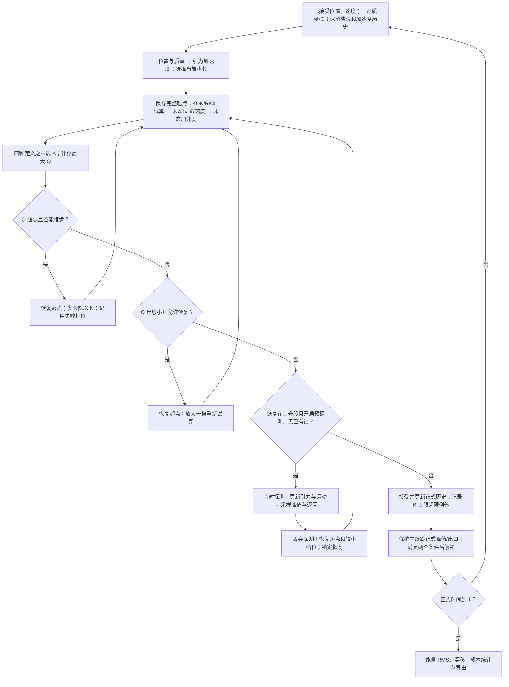

# Work scale 四种方法与预探测：当前研究说明

更新：2026-11-02。[English specification](adaptive-stepping.md) · [实验数据与结论](reports/2026-11-02-work-scale/README.md)。

## 正在研究什么

我正在比较自己提出的做功规模判据及 Original、Align、Average、Predicted 四种取值方式，检验它们在近距离相遇中能否以可接受的计算成本降低能量误差，同时观察能量漂移。现阶段保留对照与反例，还没有一种方法在所有轨道和指标上统一胜出。程序使用 Work scale 名称，早期讨论中的 Work skill 指同一研究线。

直观上，接近过程中引力和运动可能迅速变化。大步长可能跨过关键变化；全程采用最小步长又可能浪费平缓阶段的计算。因此，我尝试估计“这一步涉及多大的能量交换尺度”，据此缩步或恢复。

高加速度、能量交换大和数值误差大，是三个不同概念。这个判据是选择时间分辨率的启发式方法，不能把三者等同。

## 已知量怎样进入下一步

当前已接受时刻记为 t_n。已知每个粒子的质量 m_i、位置 r_i,n、速度 v_i,n，以及由全部位置和质量计算的总引力加速度 a_i,n。i 是粒子编号，n 是时刻编号。固定参数为 G=1、最大初始步长 h0、结束时间 T、缩放因子 N、最大细分指数 K 和阈值 q。这里 N 是步长倍率，不是粒子数。

位置和质量 → 相互引力与总加速度 → 按 KDK/RK4 试算位置和速度 → 新位置产生末态加速度 → 计算判据 → 接受或回退。只有接受后，新状态才进入下一轮。回退重算是同一物理起点的内部试算，不是正式时间继续向前推进。

## Work scale 实际算什么

$$Q_i=\frac{m_i}{S_E}\left(|\mathbf A_i\cdot\mathbf v_{i,n}|h+\frac12|\mathbf A_i|^2h^2\right),\qquad Q=\max_iQ_i,$$

$$S_E=E_{\rm kin}(0)+|E_{\rm pot}(0)|.$$

A_i 是所选版本的有效加速度向量；v_i,n 始终取步初速度；h 是本次实际试算步长。点乘取速度沿加速度方向的贡献；竖线对标量表示绝对值、对向量表示长度；max 表示选择所有粒子中最大的 Q_i。E_kin(0)、E_pot(0) 是初始动能、势能；S_E 整次运行固定。

质量、位置、速度、加速度、时间和能量采用代码的质量、长度、长度/时间、长度/时间²、时间、质量×长度²/时间²单位。两项各乘质量后都有能量单位，除以 S_E 后 Q 无量纲。用动能加势能绝对值，是为避免总能量因正负抵消接近零，异常放大归一化数值。

直观来源是位移估计 v h + A h²/2。实际指标把线性项先取绝对值，再加正的平方项，不是先带符号相加再取绝对值。速度与加速度垂直时，第一项可能为零，第二项仍然存在。

**Q 不是总能量误差。** 精确解总能量守恒时，动能和势能仍会相互转化，Q 仍可很大。阈值 0.01 表示归一化做功规模，不表示真实能量误差被限制在 1%；它也不是严格的局部截断误差估计。改变惯性参考系会改变速度与归一化尺度，无量纲不代表参考系不变。

## 四种版本差在哪里

a_start 为已接受起点加速度，a_end 为试算末态加速度，a_prev 为上一个已接受时刻的加速度。它们都是向量。

| 版本 | 最终代入的 A | 目的与边界 |
|---|---|---|
| Original：`work_step` | a_end | 利用末态力；与起点速度混合使用 |
| Align：`work_step_align` | a_start | 加速度与速度来自同一起始时刻；不利用末态变化 |
| Average：`work_step_average` | (a_start+a_end)/2 | 同时用两个端点；方向相反时向量可能抵消 |
| Predicted：`work_step_predicted` | a_start+(a_start−a_prev)/2 | 用两个已接受状态作半差分外推；指标不使用试算末态加速度 |

四种方法的速度都取步初值，线性项与平方项使用同一个 A。Average 先平均向量，再点乘、平方；不是平均指标，也不是平均加速度大小。

Predicted 按我确认的例子：前次 1、本次 2，直接代入 2.5，不再平均成 2.25。首步没有历史时使用当前初始加速度。被拒绝的试算不进入历史。当前外推没有按前后步长比修正，不能视作通用变步长下的物理时间导数预测。四种方法都照常计算积分器需要的实际引力。

## 如何缩步、恢复与接受

名义步长为 h0/N^k，k 从 0 到 K，是保存到下一步的档位，不是每步重置的重试计数。

1. 保存正式起点与力计算缓存，按当前档位试算，得到 Q。
2. Q>q 且未到 K：拒绝，恢复同一起点，k 加一，步长除以 N 重算。记住当前起点已失败的档位，避免恢复时反复循环。
3. Q<q/N 且允许恢复：恢复同一起点，k 减一，用大一档步长重新检验。小步通过不代表大步自动通过。预探测锁、失败档位及结束时间裁剪可能阻止恢复。
4. 无需继续重试时接受。若已到 K 而 Q 仍超限，程序接受并记录异常，不无限缩步；无效或无穷大的物理状态仍停止。
5. 只有已接受的时间、位置、速度、加速度和能量进入正式记录，供下一步与统计使用。

## 遇到的困难、排查和预探测

问题是：强加速度相遇附近，步长有时反而恢复变大。我把加速度、速度投影、做功指标和步长放在同一时间轴检查异常点，发现采样、运动几何和局部指标变小可能让恢复发生过早。

需要区分观察与理论：连续峰值不一定落在保存的采样时刻；一般多体问题中，也不能断言“加速度最大时，沿加速度方向的速度必定为零”。当前程序直接跟踪采样的全系统最大加速度大小，不依赖这条断言。

为此加入可选的 Encounter Pre-probe（相遇预探测）：

1. 本次试算准备接受比本轮开始更大的步长档位，而起点附近或试算跨越中的加速度仍在上升，且没有已有保护时，触发探测。
2. 从保存起点，用拟恢复的大步长临时向前算。探测只测量 Q，不按 Q 回退；寻找采样加速度经过峰值、再回到入口水平的区间。到 T 或数值故障也会结束探测。
3. 丢弃临时状态，恢复完整正式起点，恢复本轮开始时较小的档位。正式重算允许继续缩步，但禁止恢复放大，所以不是严格固定步长重放。
4. 正式轨迹既到达探测结束时间，又经过自身峰值并回到入口水平后，解除保护。到 T 时正常结束。探测轨迹和正式轨迹可以不同，采样峰值不是精确解峰值。

可以用“先探路，再回到原处正式通过危险区间”帮助理解，但这只是比喻。程序并不知道真实未来，探路也有误差和成本。预探测不是能量修正，不保证消除漂移。

Predicted 在探测内部维护独立的两次加速度历史，不把临时数据混入正式历史。计算成本包括被拒绝的尝试和预探测。

## 当前证据支持的适用范围

本次 8 条触发自适应的确定初态中，四种方法配合预探测，KDK/RK4 的能量 RMS 都低于同一初始步长的固定步长基准；RK4 的拟合漂移幅度也全部降低。这支持把 RK4 的改善作为当前亮点。预选但没有触发缩步的另 4 条案例同样保留，没有计作算法获益样本。

KDK 的状态相关拒绝、恢复及历史保护不能自动继承固定步长 KDK 的时间对称性。能量振荡可以变小，拟合漂移却可能变大。预探测没有把整套控制器变成已证明时间可逆或辛的变步长方法。

RK4 的结果支持“在已测试轨道、参数和时长下，能量 RMS 和拟合漂移明显降低”，不能写成所有轨道的长期漂移都已解决，也不能由能量指标保证轨迹准确。

成本潜力在于把小步长集中到相遇区间，而不是全程细算。但同一初始步长的现有对照中，自适应通常比粗固定步长更慢。证明同精度下省时，需要扫描固定步长、阈值和档位，比较误差—耗时关系。

四种方法尚无统一赢家：Predicted 在部分 RK4 案例改善，在另一些案例变差；Average 也有反例。Goggles 十周期测试还显示，能量错误被压低不保证恢复原周期形状。详见[实验说明](reports/2026-11-02-work-scale/README.md)。

我提出问题、做功规模及其变体、排查判断和实验取舍；KDK/RK4 是已有方法，实现和测试使用 AI 辅助。现阶段将其作为可核查的数值方法探索，不宣称已证明通用优越性或完成新的天体物理发现。
